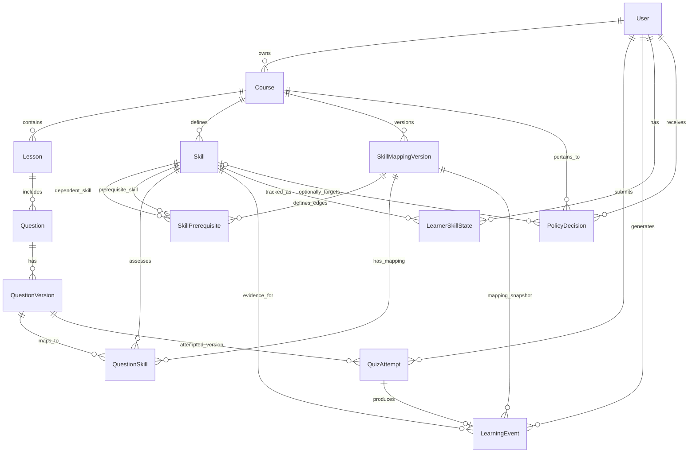

# SopiSkill – Entity Relationship Design (ERD)

| Thuộc tính | Giá trị |
|---|---|
| Phiên bản | **1.0.0** |
| Trạng thái | **Baseline đề xuất – Technical Lead duyệt trước khi lập trình** |
| Người quản lý | Project Leader / Technical Lead |
| Ngày | 21/11/2026 |
| Phạm vi | MVP 4 tuần: Course, Quiz, KC Graph, Learning Events, Rule-based Adaptive, AI Tutor |
| Tham chiếu | `docs/DATA_CONTRACTS.md` và `docs/API_CONTRACTS.md` |

> **Phạm vi tài liệu:** ERD logic và ràng buộc nghiệp vụ; **chưa phải Prisma Schema hoặc SQL migration**. Có 13 thực thể chính. Chỉ triển khai các bảng khi từng tính năng bắt đầu. RAG, BKT/PFA production, enrollments đa người học và hạ tầng benchmark là phần mở rộng.

## 1. Quyết định thiết kế đã chốt cho MVP

1. **Một Course thuộc một User**, Course là riêng tư; không làm đăng ký học nhiều người (Enrollment) ở MVP.
2. **Một Lesson có nhiều Question.** Question là định danh logic, QuestionVersion lưu nội dung và đáp án cụ thể của từng lần phát hành.
3. **Một câu hỏi đánh giá một KC chính** tại thời điểm làm bài; cấu trúc `QuestionSkill` cho phép mở rộng KC phụ nhưng MVP chưa dùng.
4. **KC được định danh bằng UUID và `skillKey` ổn định trong Course.** Đồ thị tiên quyết và ánh xạ câu hỏi cùng gắn với một `SkillMappingVersion` đã phê duyệt.
5. **QuizAttempt lưu lượt nộp** và lựa chọn của người học; **LearningEvent lưu bằng chứng** bất biến để tính trạng thái KC. MVP mỗi lượt nộp tạo tối đa một sự kiện bằng chứng cho một KC chính.
6. **LearnerSkillState là bản tổng hợp có thể tái tính**, không thay thế lịch sử LearningEvent.
7. **PolicyDecision lưu hành động gợi ý và `reasonCode`**, không coi một lời giải thích của LLM là quyết định nghiệp vụ.
8. **Backend tự chấm**; frontend tuyệt đối không nhận `answerKey` trước khi hoàn thành/chấm bài.
9. **Không xóa cứng dữ liệu đã có lịch sử học tập.** Dùng trạng thái/ẩn/khóa phiên bản hoặc chính sách lưu trữ, xóa dữ liệu riêng tư khi có yêu cầu hợp lệ.
10. Tên model Prisma là `PascalCase` số ít, field `camelCase`; bảng/cột PostgreSQL là `snake_case`, tên bảng số nhiều, dùng Prisma `@map`/`@@map` khi triển khai.

## 2. Sơ đồ ERD (Mermaid)

**Cách đọc:** `||--o{` = một tới nhiều (có thể bằng 0); `||--o|` = một tới 0 hoặc 1. `SkillPrerequisite` tham chiếu **hai lần** đến `Skill`: cạnh từ `prerequisiteSkillId` (kỹ năng học trước) tới `skillId` (kỹ năng phụ thuộc).

## 3. Danh sách 13 thực thể

### 3.1. User → `users`

| Field (Prisma/API) | Kiểu logic | Ràng buộc / ý nghĩa |
|---|---|---|
| `id` | UUID | PK; server tạo |
| `email` | string | Unique, normalized, required |
| `passwordHash` | string | Bắt buộc đối với đăng nhập email; tuyệt đối không trả về frontend |
| `createdAt` | timestamp UTC | Required |
| `updatedAt` | timestamp UTC | Required |

Quan hệ: `User 1:N Course`, `QuizAttempt`, `LearningEvent`, `LearnerSkillState`, `PolicyDecision`.

**Ghi chú:** Bảng quản lý Refresh Token sẽ được bổ sung trong thiết kế Auth riêng; không gộp token vào `users`.

### 3.2. Course → `courses`

| Field | Kiểu logic | Ràng buộc / ý nghĩa |
|---|---|---|
| `id` | UUID | PK |
| `ownerId` | UUID | FK → `users.id`, required |
| `title` | string | Required |
| `description` | string? | Optional |
| `status` | CourseStatus | `draft`, `awaiting_approval`, `generating`, `ready`, `failed`, `archived` |
| `createdAt`, `updatedAt` | timestamp UTC | Required |

Quan hệ: `Course 1:N Lesson`, `Skill`, `SkillMappingVersion`, `PolicyDecision`.

**Quyền sở hữu:** mọi API Course kiểm tra người đang đăng nhập là `ownerId`.

### 3.3. Lesson → `lessons`

| Field | Kiểu logic | Ràng buộc / ý nghĩa |
|---|---|---|
| `id` | UUID | PK |
| `courseId` | UUID | FK → `courses.id` |
| `title` | string | Required |
| `position` | int | ≥ 1; unique `(courseId, position)` |
| `content` | text | Nội dung bài học (chưa cần version ở MVP) |
| `createdAt`, `updatedAt` | timestamp UTC | Required |

Quan hệ: `Lesson 1:N Question`.

### 3.4. Question → `questions`

| Field | Kiểu logic | Ràng buộc / ý nghĩa |
|---|---|---|
| `id` | UUID | PK – ID câu hỏi logic |
| `lessonId` | UUID | FK → `lessons.id` |
| `status` | string | `draft`, `active`, `archived` |
| `createdAt` | timestamp UTC | Required |

**Không lưu nội dung/đáp án thay đổi được trực tiếp tại đây.** Dùng `QuestionVersion`.

### 3.5. QuestionVersion → `question_versions`

| Field | Kiểu logic | Ràng buộc / ý nghĩa |
|---|---|---|
| `id` | UUID | PK – định danh phiên bản cụ thể |
| `questionId` | UUID | FK → `questions.id` |
| `versionNumber` | int | ≥ 1; unique `(questionId, versionNumber)` |
| `prompt` | text | Nội dung câu hỏi |
| `options` | JSONB | Danh sách `{id, text}`; `id` option ổn định trong phiên bản |
| `answerKey` | string / JSONB | **Server-only**, không nằm trong DTO công khai |
| `explanation` | text? | Dùng sau khi chấm theo chính sách Tutor |
| `createdAt` | timestamp UTC | Required |

**MVP:** một dạng câu hỏi trắc nghiệm một lựa chọn; nếu sửa ý nghĩa nội dung hoặc đáp án thì **tạo phiên bản mới**. Không sửa đè câu đã phát hành và có lượt nộp.

### 3.6. Skill → `skills`

| Field | Kiểu logic | Ràng buộc / ý nghĩa |
|---|---|---|
| `id` | UUID | PK |
| `courseId` | UUID | FK → `courses.id` |
| `skillKey` | string | Unique `(courseId, skillKey)`; ổn định theo KC |
| `name` | string | Tên kỹ năng |
| `description` | text? | Optional |

Ví dụ `KC-LL-03` = thao tác chèn node. `skillKey` không phải PK và không tự tạo lại khi sinh nội dung mới.

### 3.7. SkillMappingVersion → `skill_mapping_versions`

| Field | Kiểu logic | Ràng buộc / ý nghĩa |
|---|---|---|
| `id` | UUID | PK |
| `courseId` | UUID | FK → `courses.id` |
| `versionNumber` | int | Unique `(courseId, versionNumber)` |
| `status` | string | `draft`, `approved`, `retired` |
| `approvedAt` | timestamp UTC? | Bắt buộc khi approved |
| `createdAt` | timestamp UTC | Required |

**Ý nghĩa:** version của cả **đồ thị tiên quyết** (`SkillPrerequisite`) và **ánh xạ câu hỏi** (`QuestionSkill`). Một khi approved và đã được sử dụng để chấm điểm thì giữ nguyên các cạnh/ánh xạ thuộc version đó.

### 3.8. SkillPrerequisite → `skill_prerequisites`

| Field | Kiểu logic | Ràng buộc / ý nghĩa |
|---|---|---|
| `id` | UUID | PK |
| `mappingVersionId` | UUID | FK → `skill_mapping_versions.id` |
| `skillId` | UUID | FK → `skills.id`; kỹ năng phụ thuộc |
| `prerequisiteSkillId` | UUID | FK → `skills.id`; kỹ năng phải học trước |

Unique `(mappingVersionId, skillId, prerequisiteSkillId)`. Không cho `skillId = prerequisiteSkillId`. Hai skill phải thuộc cùng Course với version. Kiểm tra toàn bộ graph **không có chu trình bằng DFS/Kahn** trước khi phê duyệt.

Ví dụ `Traversal → Insertion` thì `skillId = Insertion`, `prerequisiteSkillId = Traversal`.

### 3.9. QuestionSkill → `question_skills`

| Field | Kiểu logic | Ràng buộc / ý nghĩa |
|---|---|---|
| `id` | UUID | PK |
| `mappingVersionId` | UUID | FK → `skill_mapping_versions.id` |
| `questionVersionId` | UUID | FK → `question_versions.id` |
| `skillId` | UUID | FK → `skills.id` |
| `isPrimary` | boolean | Với MVP, đúng một KC chính |

Unique `(mappingVersionId, questionVersionId, skillId)`. Với mỗi `(mappingVersionId, questionVersionId)` đã phê duyệt, bắt buộc đúng **một** mapping `isPrimary=true`. Có thể kiểm soát *tối đa một* bằng PostgreSQL partial unique index, và *ít nhất một* bằng validator lúc duyệt version.

**Không nhầm `questionId` với `questionVersionId`**: câu đã thay đổi nội dung/đáp án phải có ánh xạ của phiên bản được người học thực sự làm.

### 3.10. QuizAttempt → `quiz_attempts`

| Field | Kiểu logic | Ràng buộc / ý nghĩa |
|---|---|---|
| `id` | UUID | PK |
| `userId` | UUID | FK → `users.id` |
| `questionVersionId` | UUID | FK → `question_versions.id` |
| `mappingVersionId` | UUID | FK → `skill_mapping_versions.id` |
| `idempotencyKey` | UUID | Unique `(userId, idempotencyKey)` |
| `selectedOptionId` | string | Option đã chọn, phải thuộc question version |
| `isCorrect` | boolean | Do backend tính |
| `hintsUsed` | int | Do backend ghi nhận, không tin số client gửi |
| `submittedAt` | timestamp UTC | Server ghi |

**MVP:** một QuizAttempt là một lần nộp một câu hỏi. Retry cùng `idempotencyKey` + cùng nội dung không tạo lượt mới; cùng key + nội dung khác trả lỗi xung đột.

### 3.11. LearningEvent → `learning_events`

| Field | Kiểu logic | Ràng buộc / ý nghĩa |
|---|---|---|
| `id` | UUID | PK |
| `attemptId` | UUID | FK → `quiz_attempts.id`, unique trong MVP |
| `userId` | UUID | FK → `users.id` |
| `questionVersionId` | UUID | FK → `question_versions.id` |
| `skillId` | UUID | FK → `skills.id` (KC chính của lượt) |
| `mappingVersionId` | UUID | FK → `skill_mapping_versions.id` |
| `isCorrect` | boolean | Snapshot từ kết quả chấm |
| `hintsUsed` | int | Snapshot server-side |
| `occurredAt` | timestamp UTC | Server ghi |

**Append-only về mặt nghiệp vụ**: không sửa `isCorrect`, `skillId` hoặc version của sự kiện đã ghi. Nếu cần điều chỉnh dữ liệu sai, thực hiện quy trình correction có audit (thiết kế riêng). Với MVP không cho sửa lịch sử bằng CRUD thông thường.

**Toàn vẹn:** `QuizAttempt` + `LearningEvent` (và cập nhật trạng thái liên quan nếu đồng bộ) cần có transaction/idempotency; một lượt nộp hợp lệ không được tính hai lần.

### 3.12. LearnerSkillState → `learner_skill_states`

| Field | Kiểu logic | Ràng buộc / ý nghĩa |
|---|---|---|
| `id` | UUID | PK |
| `userId` | UUID | FK → `users.id` |
| `skillId` | UUID | FK → `skills.id` |
| `status` | MasteryStatus | `insufficient_data`, `learning`, `proficient`, `needs_review` |
| `modelType` | string | MVP: `rule_based` |
| `modelVersion` | string | Ví dụ `rule-v1` |
| `updatedAt` | timestamp UTC | Required |

Unique `(userId, skillId)` cho trạng thái **được ứng dụng sử dụng hiện tại**. Nếu nghiên cứu nhiều mô hình đồng thời, lưu kết quả offline riêng hoặc mở rộng khóa `(userId, skillId, modelType, modelVersion)` và định nghĩa một active state.

**Quan trọng:** đây là bản tổng hợp, luôn có thể tái tính từ LearningEvent còn hiệu lực.

### 3.13. PolicyDecision → `policy_decisions`

| Field | Kiểu logic | Ràng buộc / ý nghĩa |
|---|---|---|
| `id` | UUID | PK |
| `userId` | UUID | FK → `users.id` |
| `courseId` | UUID | FK → `courses.id` |
| `targetSkillId` | UUID? | FK → `skills.id` nếu có |
| `action` | PolicyAction | `review_skill`, `practice_skill`, `next_lesson`, `mini_pretest`, `continue_learning` |
| `reasonCode` | string | Mã giải thích máy đọc được, không chỉ text LLM |
| `policyVersion` | string | Ví dụ `adaptive-v1` |
| `createdAt` | timestamp UTC | Server ghi |

`targetSkillId` có thể null khi tiếp tục học theo bài. Luôn kiểm tra `targetSkillId` (nếu có) thuộc Course, và người dùng có quyền trên Course.

## 4. Quan hệ, khóa ngoại và chỉ mục trọng điểm

| Quan hệ | Cardinality | Hành động khi xóa / ghi chú |
|---|---|---|
| User → Course | 1:N | Không xóa cứng Course đã có attempt/event |
| Course → Lesson / Skill / SkillMappingVersion | 1:N | Dữ liệu theo phạm vi Course |
| Lesson → Question → QuestionVersion | 1:N → 1:N | Version có lịch sử không được sửa/xóa cứng |
| SkillMappingVersion → SkillPrerequisite / QuestionSkill | 1:N | Version approved là bất biến |
| QuestionVersion → QuizAttempt | 1:N | Không xóa version có attempt |
| QuizAttempt → LearningEvent | 1:0..1 | Unique attemptId; MVP sinh 1 event khi attempt hợp lệ |
| User + Skill → LearnerSkillState | N:1 + N:1 | Unique composite `(userId, skillId)` |
| User + Course → PolicyDecision | N:1 + N:1 | Có thể chọn skill mục tiêu |

**Chỉ mục gợi ý** (ngoài PK, unique tạo chỉ mục):

- `courses(owner_id, created_at DESC)`.
- `lessons(course_id, position)` (unique).
- `questions(lesson_id)`; `question_versions(question_id, version_number)` (unique).
- `skills(course_id, skill_key)` (unique).
- `skill_mapping_versions(course_id, version_number)` (unique).
- `question_skills(mapping_version_id, question_version_id)`; unique primary mapping theo điều kiện `is_primary=true`.
- `quiz_attempts(user_id, submitted_at DESC)`, unique `(user_id, idempotency_key)`.
- `learning_events(user_id, skill_id, occurred_at DESC)`, unique `attempt_id`.
- `learner_skill_states(user_id, skill_id)` (unique).
- `policy_decisions(user_id, course_id, created_at DESC)`.

**Lưu ý implementation:** Các FK đơn lẻ không đủ chứng minh một QuestionVersion/Skill cùng Course với MappingVersion. Backend phải kiểm tra, hoặc thiết kế thêm composite constraints khi chuyển sang Prisma/PostgreSQL.

## 5. Ba luồng dữ liệu cần kiểm chứng trước khi code

### 5.1. Tạo khóa học (Course Generation)

1. User xác thực tạo Course ở `draft`/`awaiting_approval`.
2. Worker sinh đề cương và nội dung theo schema; server kiểm tra kết quả.
3. Tạo Lesson, Skill, Question, QuestionVersion và bản `SkillMappingVersion` ở `draft`.
4. Tạo SkillPrerequisite + QuestionSkill theo version đó.
5. Validator kiểm tra skill keys, không có chu trình, mapping đúng phạm vi Course, mỗi câu có KC chính.
6. Sau khi được duyệt, khóa mapping `approved`, Course `ready` khi học liệu sẵn sàng.

**MVP cần thiết kế trạng thái tác vụ riêng** (queue/job metadata). `GenerationJob` có thể bổ sung sau, không nằm trong 13 bảng lõi ở đây.

### 5.2. Làm Quiz (QuizAttempt → LearningEvent)

1. Frontend nhận câu hỏi/option **không có `answerKey`**.
2. Người học chọn option và gửi `Idempotency-Key`.
3. Backend lấy QuestionVersion, answerKey và MappingVersion hợp lệ, kiểm tra Course.ownerId.
4. Backend chấm điểm, lấy KC chính, ghi QuizAttempt và LearningEvent trong transaction, chống trùng request.
5. Cập nhật hoặc tính lại LearnerSkillState theo Rule-based v1.
6. Response trả `isCorrect`, feedback, trạng thái kỹ năng; không trả dữ liệu nhạy cảm ngoài phạm vi cần thiết.

### 5.3. Gợi ý Adaptive (LearningEvent → State → PolicyDecision)

1. Backend đọc các LearningEvent hợp lệ theo `(userId, skillId)` và thời gian.
2. Rule-based Mastery tính `insufficient_data` / `learning` / `proficient` / `needs_review`.
3. Adaptive Policy đọc SkillPrerequisite của MappingVersion **đang dùng**, kiểm tra prerequisite.
4. Chọn hành động `review_skill`/`practice_skill`/`next_lesson`..., ghi PolicyDecision + `reasonCode` + `policyVersion`.
5. Frontend hiển thị gợi ý và lý do; người học có thể tiếp tục hoạt động khác theo chính sách sản phẩm.

## 6. Các thiết kế tách khỏi 13 thực thể lõi

Các thành phần sau **không bị loại bỏ**, nhưng cần tài liệu/schema riêng khi đến giai đoạn triển khai:

- **Auth Session:** `refresh_sessions` / `refresh_tokens` để rotate, revoke và quản lý phiên đăng nhập.
- **AI Generation Jobs:** bảng metadata cho generation run, job status, retry, token usage/cost, provider/model benchmark (không gắn production model trước khi chọn).
- **Tutor:** phiên chat, tin nhắn, hint events để tính số gợi ý đúng từ server.
- **RAG:** source, source version, document chunks, citations và pgvector – chỉ sau Adaptive core.
- **BKT/PFA offline:** tham số mô hình, bản dự đoán shadow, dataset splits; không ghi đè state production.
- **Enrollment:** chỉ khi Course có nhiều người học, vượt ngoài MVP user-owned private course.
- **Privacy:** yêu cầu xóa dữ liệu/ẩn danh và retention theo chính sách riêng.

## 7. Những quyết định phải kiểm tra trong review của cả nhóm

- [ ] Mỗi Course có một Owner và private ở MVP.
- [ ] Câu hỏi trước khi nộp không lộ answerKey.
- [ ] QuestionVersion và SkillMappingVersion không bị sửa đè khi đã dùng.
- [ ] Một câu hỏi có đúng một KC chính tại mỗi mapping version approved.
- [ ] SkillPrerequisite kiểm tra self-loop, cross-course và cycle.
- [ ] QuizAttempt có idempotency và server-side grading.
- [ ] LearningEvent có snapshot version và bất biến về mặt nghiệp vụ.
- [ ] LearnerSkillState có thể tái tính từ events.
- [ ] PolicyDecision có reasonCode và version thuật toán.
- [ ] Bổ sung bảng Auth/Jobs/Tutor trước khi code chức năng tương ứng.

## 8. Phân trách nhiệm review

| Vai trò | Nội dung bắt buộc kiểm tra |
|---|---|
| Technical Lead / Backend | PK/FK, cardinality, owner, transaction, index, migration, khả năng triển khai Prisma |
| AI / Algorithms | DAG, stable KC keys, mapping version, learning evidence, policy input/output, benchmark leakage |
| Frontend / Quality | DTO hiển thị, trường công khai/nhạy cảm, quiz request, loading/job status, E2E scenarios |

**Definition of Done cho ERD:** Ba luồng Course → Quiz → Adaptive mô tả thông suốt; không có quan hệ thiếu khóa, phiên bản hoặc quyền sở hữu; toàn nhóm xác nhận và ghi nhận thay đổi qua Pull Request trước khi chuyển sang Prisma.

---

### Phê duyệt

- **Technical Lead:** Chưa ký xác nhận.
- **Frontend Reviewer:** Chưa review.
- **AI/Algorithm Reviewer:** Chưa review.
- **Next step:** Phê duyệt ERD → thiết kế `API_CONTRACTS.md` → chuyển ERD thành Prisma Schema và migrations, thực hiện theo từng module.
